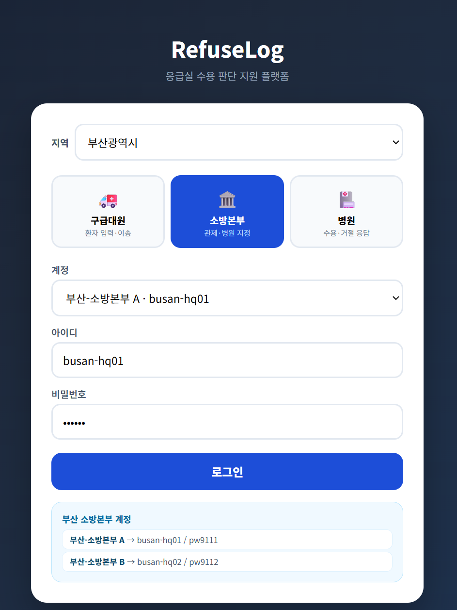
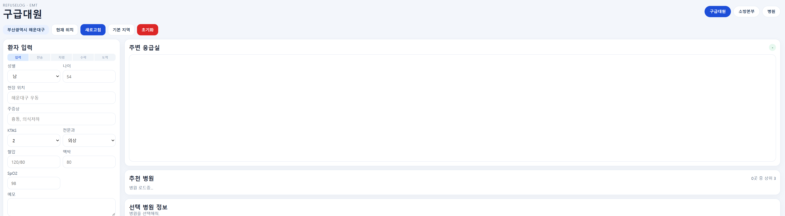
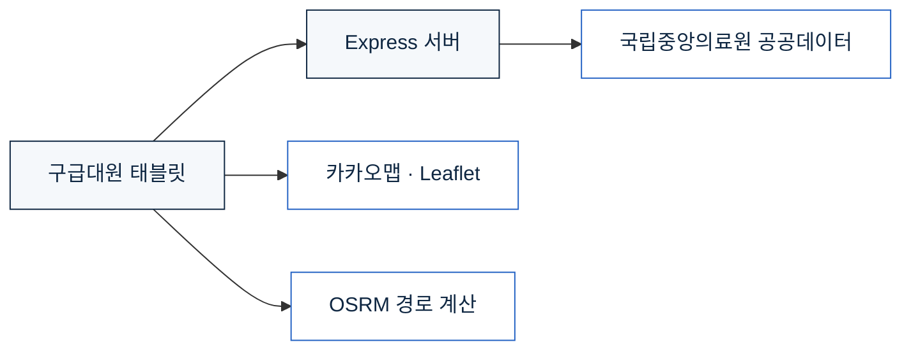

<!--
  README 작성 메모 (GitHub 화면에는 보이지 않습니다)
  - "확인 필요" 주석이 달린 곳은 코드에서 추측한 내용입니다. 실제와 다르면 고쳐 주세요.
  - 로고 파일은 docs/assets/saegyeol-logo.png 경로에 넣어 주세요.
  - 스크린샷은 docs/assets/ 아래에 넣고 파일명을 맞춰 주세요.
-->

<p align="center">
  
</p>

<h1 align="center">refuse log</h1>

<!-- 확인 필요: 프로젝트 한 줄 소개 -->
<p align="center">
  구급대가 응급실에서 수용을 거절당한 기록을 남기고,<br>
  지금 환자를 받을 수 있는 병원을 지도에서 바로 찾을 수 있게 합니다.
</p>

<p align="center">
  
  
  
</p>

---

## 소개

<!-- 확인 필요: 문제 정의. 실제로 만든 이유에 맞게 고쳐 주세요 -->
구급차가 환자를 태운 뒤 받아 줄 병원을 찾지 못해 여러 응급실을 돌아다니는 일이 반복됩니다. 어느 병원이 왜 거절했는지는 기록으로 잘 남지 않습니다. 그래서 다음 출동에서도 같은 병원에 다시 전화를 걸게 됩니다.

refuse log는 구급대원이 태블릿에서 병원 상황을 보고, 거절당한 내역을 바로 남길 수 있게 만든 데모입니다. 응급실 정보는 국립중앙의료원 공공데이터를 주기적으로 받아 지도에 표시합니다.

## 화면

| 로그인 | 구급대원 태블릿 화면 |
|---|---|
|  |  |

<!-- 지도 동작을 보여 주는 GIF가 있으면 아래 줄의 주석을 풀어 주세요 -->
<!--  -->

## 주요 기능

- **지역별 로그인**: 시도 17곳마다 데모 계정이 있습니다.
- **병원 지도**: 응급실 위치와 상태를 지도에 표시합니다. 지도는 카카오맵과 Leaflet을 씁니다.
- **경로 안내**: 현재 위치에서 병원까지 가는 길을 OSRM으로 계산합니다.
- **병원 정보 자동 갱신**: 국립중앙의료원 데이터를 정해진 주기마다 다시 불러옵니다.
- **수용 거절 기록**: 어느 병원에서 어떤 이유로 거절당했는지 남깁니다. <!-- 확인 필요 -->

## 구조



## 기술 스택

| 구분 | 사용한 것 |
|---|---|
| 서버 | Node.js, Express, dotenv |
| 화면 | HTML, CSS, JavaScript |
| 지도 | 카카오맵 JavaScript SDK, Leaflet |
| 경로 | OSRM 공개 API |
| 데이터 | 국립중앙의료원 응급의료 공공데이터 (공공데이터포털) |

## 실행 방법

Node.js가 설치되어 있어야 합니다.

```bash
git clone https://github.com/[계정]/[저장소].git
cd [저장소]
npm install
cp .env.example .env
```

`.env`에 키를 입력합니다.

```
NEMC_SERVICE_KEY=   # 공공데이터포털에서 발급한 서비스 키
GOOGLE_MAPS_API_KEY=
```

카카오맵 키는 `public/emt-tablet.html`에서 `YOUR_KAKAO_JS_KEY` 자리에 넣습니다. 키는 [카카오 개발자 사이트](https://developers.kakao.com)의 내 애플리케이션 → 앱 키에서 발급하고, 플랫폼 → Web에 실행할 도메인(`http://localhost:포트`)을 등록해야 지도가 뜹니다.

<!-- 확인 필요: package.json의 실행 스크립트와 포트 -->
```bash
npm start
```

브라우저에서 `http://localhost:3000`으로 접속합니다.

## 데모 계정

로그인 화면의 계정은 시연용입니다. 지역별 아이디와 비밀번호는 `public/login.html`에 있습니다. 실제 사용자 정보와는 관계가 없습니다.

## 알려진 한계

이 저장소는 동작을 보여 주기 위한 데모입니다. 실제 현장에서 쓰려면 아래 부분을 바꿔야 합니다.

- 로그인은 브라우저의 localStorage에서만 처리합니다. 서버에서 사용자를 확인하지 않으므로 누구나 화면에 들어갈 수 있습니다.
- 데모 계정과 비밀번호가 코드에 그대로 들어 있습니다.
- 병원 데이터 일부는 시연을 위한 가상 데이터입니다. 실제 환자 정보는 없습니다.
- 경로 계산에 OSRM 공개 서버를 씁니다. 요청이 많아지면 직접 서버를 띄워야 합니다.

## 팀

<!-- 팀 프로젝트라면 채워 주세요. 혼자 만들었다면 이 섹션을 지워도 됩니다 -->
| 이름 | 맡은 일 |
|---|---|
| 황지후 | [맡은 일] |
| [이름] | [맡은 일] |

## 출처

- 응급의료 데이터: 국립중앙의료원, 공공데이터포털
- 지도: 카카오맵 JavaScript SDK (카카오 개발자 이용약관), [Leaflet](https://leafletjs.com) (BSD-2-Clause)
- 경로: [OSRM](https://project-osrm.org), 지도 데이터 © OpenStreetMap 기여자 (ODbL)

## 라이선스

[MIT](LICENSE)
